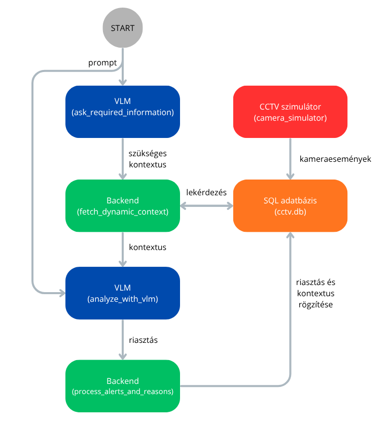

# CCTV Backend

## Az üzleti logika

A backend elindításakor (main.py) bekérünk egy promptot, a felhasználótól (pl. "Jelezz, ha füstöt látsz"). Minden futtatásban egy prompt szerint értékeljük ki a kameraeseményeket, ezért az új prompthoz a main.py leállítása és újraindítása kell. A megadott promptot átadjuk a VLM-nek, ami kizárólag a szöveges információ alapján eldönti, hogy milyen információra van szüksége a döntéshez. A következő információk közül választhat:

- A kameraeseményhez tartozó egy képkocka (single frame)
- A kameraeseményhez tartozó 10 másodperces videó
- Több egymás utáni kameraesemény videói valamilyen hosszúságú időablakkal (amikor a döntéshez hosszabb kontextusra van szükség)
- A döntés meghozatalához nem adnak elég információt a kamerák

A VLM visszatér a prompt eldöntéséhez szükséges kontextussal. Ez a teljes futás alatt állandó lesz, hiszen maga a prompt sem változik. Ezután egy végtelen ciklus következik, amit a program megszakításával (CTRL+C) állíthatunk le. A végtelen ciklus során szimuláljuk a valós kamerarendszer működését (camera_simulator.py). Ez a modul előre meghatározott kameraeseményeket rögzít az adatbázisunkban (cctv.db, camera_events tábla) bizonyos időközönként. Az üzleti logikát mindenképpen a valós idejű riasztási rendszerként akartam megvalósítani. Ahelyett, hogy a már előre rögzített kameraeseményeken megy végig a program egyesével, szimulálni akartam, hogy hogyan működik, ha a kameraesemények folyamatosan érkeznek és azokat egyből fel kell dolgozni. A szimulált kamera az eseményt azonosító inkrementális id-t, a kamera azonosítóját, az időpontot, a jelenlegi projektben ténylegesen nem létező kép és videó fájlok elérési útvonalát, illetve az is_analyzed = 0-t rögzíti. Ezeken kívül, még van egy event_type attribútum is. Ez a kameraesemény triggerelését leíró állapot (pl. mozgást érzékelt a kamera). A példa szcenáriókban láthatjuk, hogy itt van például smoke event is, ami azt feltételezné, hogy a kamera már magától képes ennek a detektálására. Ez a jelenlegi prototípus projektben csak azért van így, mert a mock VLM az event_type alapján fog döntést hozni. Egy valódi VLM-nek erre nyilván nem lenne szüksége.

A végtelen ciklus során a backend figyeli, hogy van-e új kameraesemény az adatbázisban (is_analyzed = 0). Amennyiben van, akkor annak lekérdezi a prompt eldöntéséhez releváns kontextusát (egy frame, egy videó vagy az elmúlt valamennyi idő során keletkezett videók listája). A promptot és a releváns kontextust átadja a VLM-nek, ami döntést hoz a riasztásról. A VLM itt egy egyszerű mocknak lett kialakítva. Van egy kisméretű, előre meghatározott szabályrendszere, ami alapján dönt. A legtöbb ilyen döntést a kamera által a kameraeseménybe rögzített event_type attribútum alapján teszi. A VLM visszaad egy riasztási állapotot (true vagy false), illetve egy rövid indoklást a döntéshez. Amennyiben riasztás keletkezett, azt a backendnek le kell kezelnie.

Egy állapot, ami riasztást okoz (pl. füst van) sok ideig fennállhat. A kamera 10 másodpercenként új eseményt generál, de mindegyikre külön riasztást kiadni nem lenne értelme. Ezért ha a VLM riasztást ad, akkor meg kell vizsgálnunk a korábbi állapotot. Az adatbázisból lekérdezzük az adott kamerához tartozó utolsó riasztást. Amennyiben ez 15 másodpercen belül keletkezett, akkor az aktuális riasztás ennek a kiterjesztése lesz. Ha régebben, akkor új riasztást hozunk létre. A riasztást az adatbázis alerts táblájába mentjük. Minden riasztás egyedi azonosítóval, illetve kezdő és vég időponttal rendelkezik. A riasztás kiterjesztése azt jelenti, hogy a riasztás vég időpontját módosítjuk. A riasztásokhoz a döntés alapjául szolgáló kontextust (framek vagy videók) is szeretnénk elmenteni. Ezeket az alert_reason táblába mentjük, ahol a riasztás egyedi azonosítójával le lehet kérdezni az összes releváns kontextust. Például ha egy prompt egy frame alapján eldönthető, de az állapot egy teljes percig fennáll, akkor 10 másodpercenként összesen 6 kameraesemény fog készülni. Ebből csak egy riasztás lesz, viszont az alert_reason táblába mind a hat kép elérési útvonalát elmentjük.

A ciklus végén az adott kameraeseményt megvizsgáltnak (is_analyzed = 1) állítjuk, majd várunk a kamera szimulátor újabb eseményére.

<div align="center">
  <figure style="display: inline-block;">
    
  </figure>
</div>

## Demonstráció

Az elkészített rendszert különböző kameraesemény sorozatok és promptok szerint lehet tesztelni. A kameraesemények beállítása a camera_simulator.py-ban a SIMULATION_SCENARIO változó megadásával lehetséges. Egyedi kameraesemény sorozatot is létrehozhatunk (SIMULATION_SCENARIO = 5), viszont arra figyeljünk, hogy az event_id-k inkrementálva legyenek.

### A demonstrációs esetek:

### Egy frame alapján eldönthető & pozitív eset:
- SIMULATION_SCENARIO = 1
- Prompt: "Jelezz, ha füstöt látsz" (a füst szóra és a smoke event_type-ra fog riasztást adni a mock VLM)
- Eredmény: A backend az első kameraesemény hatására rögzíti a riasztást az adatbázisban. A második kameraeseménynél nem keletkezik új riasztás (15 másodpercen belül történt), de az alert_reason táblába az új frame is el lesz mentve releváns kontextusként. A riasztás időtartama is felül lesz írva a második kameraesemény hatására.

### Egy frame alapján eldönthető & negatív eset:

- SIMULATION_SCENARIO = 2
- Prompt: "Jelezz, ha füstöt látsz"
- Eredmény: A kameraesemények között csak olyanok vannak, amiket egy autó jelenléte triggerelt. Füstöt nem látott a kamera, így egyik kameraeseménynél sem keletkezik riasztás.

### Egy videó alapján eldönthető:
- SIMULATION_SCENARIO = 3
- Prompt: "Jelezz, ha valaki szalad" (a szalad szóra és a movement event_type-ra fog riasztást adni a mock VLM)
- Eredmény: A VLM az első futtatásakkor megállapítja, hogy ehhez a prompthoz videóra van szüksége. Ennek megfelelően később a videó elérési útvonalát adjuk át. Az első kameraeseményre teljesül a feltétel, így riasztást ad a rendszer. A második kameraeseménynél ezt a riasztást bővítjük ki. A harmadik kameraeseménynél már nem igaz a riasztás, így ez negatív eset lesz. Ezt nem fűzzük hozzá a már meglévő riasztáshoz. Az alert_reason táblába a releváns kontextushoz a videó elérési útvonalát mentjük el (az első két kameraeseményhez tartozókat).

### Hosszabb kontextus szükséges:
- SIMULATION_SCENARIO = 4
- Prompt: "Jelezz, ha valaki hosszan bámészkodik" (a bámészkodik szóra, a person event_type-ra és a legalább 3 kameraesemény hosszú kontextusra ad riasztást)
- Eredmény: A prompt elemzése alapján a VLM hosszabb kontextust igényel a döntéshez (az elmúlt 1 perc eseményei). Minden új kameraeseménynél lekérdezzük az utóbbi egy perc eseményeit és átadjuk a hozzá tartozó videókat a VLM-nek. Az első kettő kameraesemény alapján még nem fog riasztást adni, mert az előre eldöntött szabály alapján legalább három videóra van szüksége. A harmadik kameraeseménynél már ad riasztást. A releváns videókat mind elmenti az alert_reason táblába. A további kameraesemények hatására ezt a riasztást bővíti ki. Ennél a szcenáriónál fontos volt arra ügyelni, hogy mindig csak az új videókat mentse el a releváns kontextusba. Az első kameraesemény videóját például a harmadik, negyedik és ötödik kameraesemény által generált riasztás esetén is megkapta a VLM (az egy perces időablak miatt), de azt a rendszer nem mentette el újra az alert_reason táblába.

### Nincs elég információ a döntéshez:
- SIMULATION_SCENARIO = bármelyik
- Prompt: "Jelezz, ha Kovács Géza autóját látod" (A Kovács Géza névre fog reagálni a VLM)
- Eredmény: A rendszer egyből kiírja, hogy a prompt eldöntéséhez a kamerák nem szolgáltatnak elég információt (nem tudják, milyen autója van Kovács Gézának). A kameraesemények elemzése így el sem indul, a rendszer leáll.

## Felhasználói segédlet

### A projektmappa tartalma:

- main.py: A CCTV kamera backendjét megvalósító kód. A teljes üzleti logika ebben található.
- camera_simulator.py: A CCTV kamera szimulátorát megvalósító kód. Előre meghatározott kameraeseményeket rögzít előre meghatározott időközönként a camera_events táblába.
- mock_vlm: A VLM-et kiváltó, egyszerű szabályrendszer alapján működő kód. Az ask_required_information függvény a prompt alapján meghatározza, hogy milyen releváns kontextusra van szükség a döntéshez. Az analyze_with_vlm függvény a prompt és a releváns kontextus alapján eldönti, hogy küld-e riasztást vagy nem.
- Dockerfile: A docker konténer létrehozásához szükséges fájl.
- cctv.db: SQL adatbázis, három táblával (camera_events, alerts, alert_reason)

### A rendszer elindításához szükséges lépések

Docker container build:

```
docker build -t cctv-backend .
```

Docker container run:

```
docker run --rm -it -v $(pwd):/app cctv-backend
```

A CCTV backend elindítása:

```
python main.py
```

A különböző kameraesemény sorozatokat a camera_simulator.py-ban lehet beállítani.

## Tervezési megfontolások

- A rendszert mindenképpen úgy akartam kialakítani, hogy a riasztásokat valós időben kapja meg a felhasználó. Ehhez szükséges volt egy kamera szimulátort készíteni, ami kameraeseményeket rögzít bizonyos időközönként.
- A VLM kétszeri futtatása mellett döntöttem. Erre azért van szükség, mert első körben csak a promptot vizsgálja meg és előírja, hogy milyen kontextus szükséges annak az eldöntéséhez. Ez a hívás csak egyszer történik, hiszen a prompt egy futás alatt nem változik. A kameraesemény regisztrálásának hatására így már csak a megfelelő kontextust kell átadni a VLM-nek a második futtatásához. Így elkerülhető, hogy egyszerűbb promptok (pl. füst detektálás) esetén egy vagy akár több videót is fel kelljen dolgoznia a VLM-nek. Ez időt és számítási erőforrást spórol a rendszernek.
- Az SQL adatbázist úgy építettem fel, hogy abból egy UI könnyen le tudja kérdezni a releváns információkat. Az event_type a valóságban nem ad ilyen részletes információt (pl. füst detektálása), itt azért volt erre szükség, hogy a mock VLM tudjon döntést hozni.
- A camera_id segítségével komplett kamerarendszerekkel is használható a program. Minden kamera külön van kezelve, az általuk rögzített események nem befolyásolják egymást.
- Nem készül minden új kameraeseményhez riasztás. Ha a közelmúltból már van egy aktív riasztás, akkor csak azt hosszabbítjuk meg.
- A tényleges képek és videók nem léteznek ebben a prototípusban. A mock VLM amúgy sem ezek alapján dönt. Azt feltételeztem, hogy a tényleges VLM képes az elérési útvonal alapján megnyitni a képeket és videókat. Amennyiben nem, akkor természetesen ezek is beolvashatóak és átadhatóak OpenCV segítségével.

## Fejlesztési lehetőségek

- A VLM a felhasználó által írt promptot kapja meg. Ezt egy valós VLM használatánál ki kéne egészíteni a megfelelő instrukciókkal (pl. milyen típusú választ adjon vissza).
- A rendszer jelenleg csak egy prompt aktív monitorozására alkalmas. Ki lehetne úgy egészíteni, hogy egyszerre több különböző eseményt is figyeljen és riasztásokat rögzítsen.
- Az egyes kamerák pozícióját és orientációját ismerve még tágabb kontextust lehetne adni a VLM számára (pl. egymással átfedő kamerák videói).

## AI használat

A Python kódok létrehozásához használtam AI segédeszközt (Gemini). Az általam megtervezett rendszert kis elemekre bontottam és az azokat megvalósító függvényeket külön-külön hoztam létre (példa prompt: "Hozz létre egy init_database Python függvényt, ami sqlite3 segítségével létrehoz egy SQL adatbázist a következő táblákkal és oszlopokkal: ...). Szintén használtam AI segédeszközt a végleges kód átnézésére és rendezésére. Minden AI által generált kódot alaposan átnéztem és ha szükséges volt javítottam.